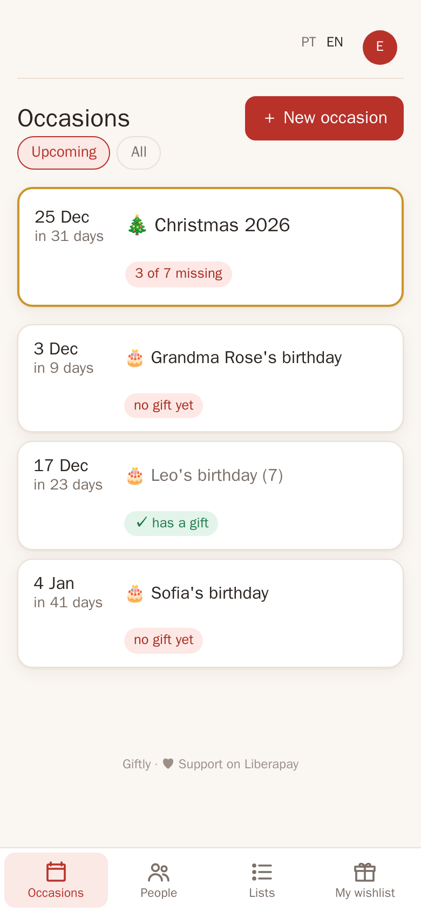
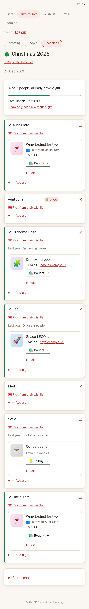
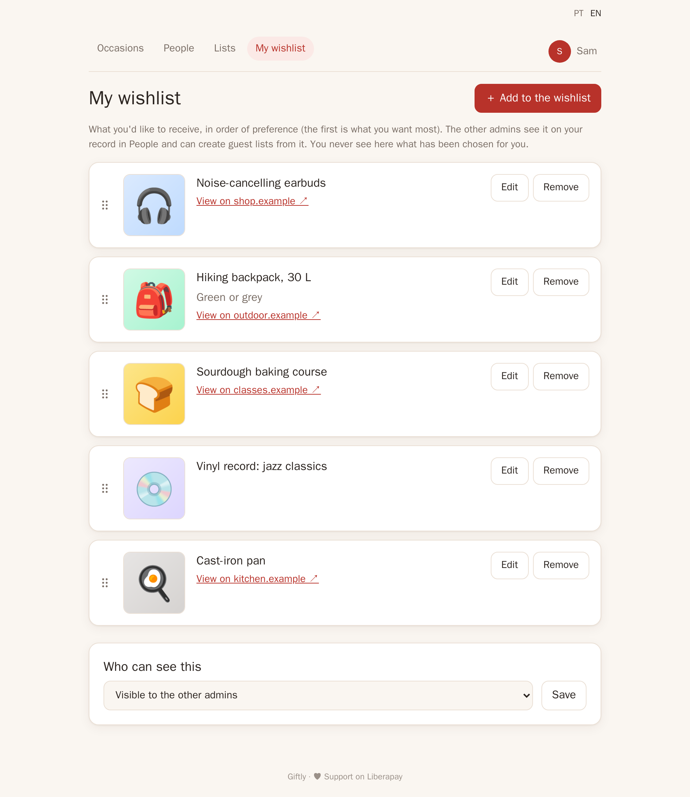
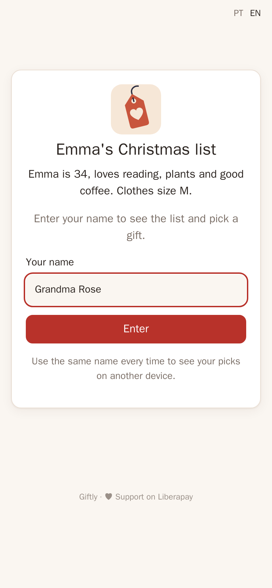
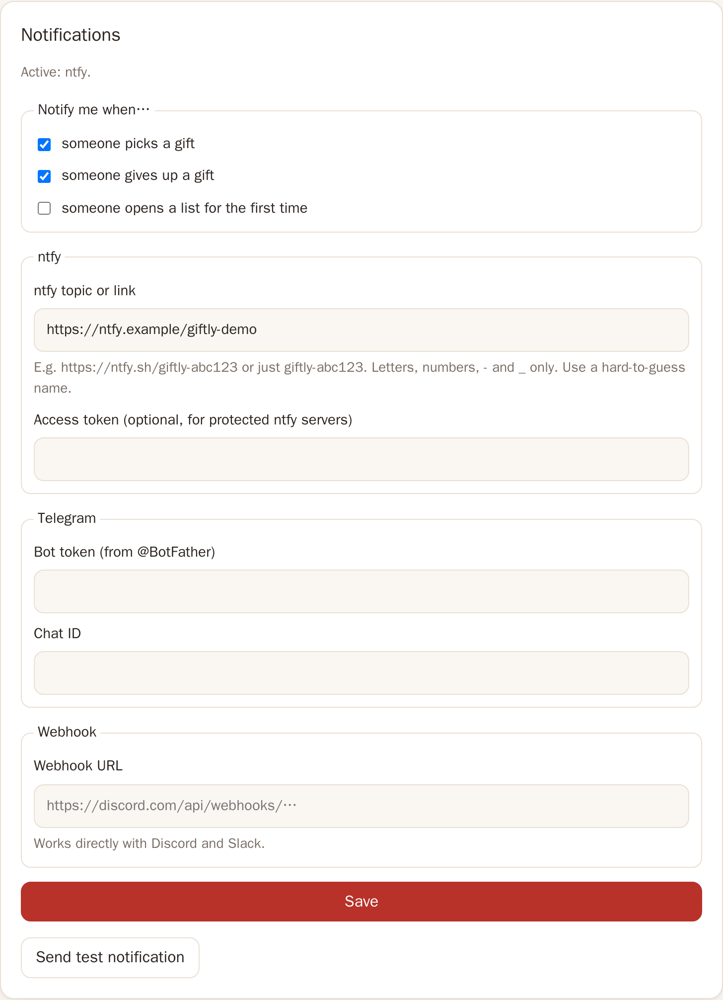

<p align="center">
  
</p>

<h1 align="center">Giftly</h1>

<p align="center"><strong>Gift lists for family and friends, on your own server.</strong><br>
No more two aunts buying the same toaster.</p>

## How it works

1. **Make a list** and add gifts: links to any shop, or plain items. Giftly shows each shop's photo and price on its own.
2. **Share the list's secret link** with family and friends.
3. **Guests open it, type their name and pick a gift.** No account, no email, no app.
4. **A picked gift disappears for everyone else**, so nobody buys the same thing twice. You see who picked what.
5. **Optional, per list:** guests say who buys the gift (they do, or they'd like you to, and you mark it once bought), see what others already reserved, and reserve on behalf of someone else.

## What else it does

- 🎁 **Wishlists.** Keep your own wishlist, and ideas for the people you give to. Turn either into a guest list in a couple of taps.
- 🤫 **Keeps the surprise.** You never see what was reserved, planned or bought for you, even as an admin.
- 📅 **Gifts you give.** Birthdays, Christmas and other occasions, with a checklist per occasion, what everyone got last year, and how much you spent.
- 🔔 **Notifications and reminders** on your phone (ntfy, Telegram, Discord, Slack) when someone picks a gift, or when a birthday is coming and there's still no gift.
- 👥 **Several admins**, each with their own account, and entries that are shared or private.
- 🌍 **Portuguese and English**, following each visitor's browser.
- 🪶 **Small and private.** One container and one SQLite file, no tracking, zero npm dependencies.

## See it

Made for the phone first. This is how guests and admins see it:

<p align="center">
  
  &nbsp;
  
  &nbsp;
  
</p>

<details>
<summary><strong>Occasions and people</strong></summary>
<p align="center">
  
  &nbsp;
  
  &nbsp;
  
</p>
</details>

<details>
<summary><strong>Lists and wishlists</strong></summary>
<p align="center">
  
  &nbsp;
  
  &nbsp;
  
</p>
<p align="center">
  
  &nbsp;
  
</p>
</details>

<details>
<summary><strong>Settings</strong></summary>
<p align="center">
  
  &nbsp;
  
</p>
</details>

## Quick start

On any machine with Docker (a NAS, a Raspberry Pi, a server):

```sh
curl -fsSL https://raw.githubusercontent.com/dfloureiro/Giftly/main/install.sh -o install.sh && sh install.sh
```

It asks for your domain and a [Cloudflare Tunnel](docs/install.md#putting-it-online-with-cloudflare-tunnel) token (both optional), creates a strong admin password, starts Giftly and tells you how to log in. **To update, run it again.**

Prefer Docker Compose, Portainer or plain `docker run`? See [Installing](docs/install.md).

## Configuration

Everything is optional. The one most people need is `BASE_URL`, the public address (e.g. `https://gifts.example.com`), as soon as Giftly is reachable from the internet. Others set the language, time zone, currency and reminder time.

All settings are in [Installing → Configuration](docs/install.md#configuration).

## Documentation

| | |
|---|---|
| [Using Giftly](docs/guide.md) | Lists and guests, wishlists, keeping the surprise, occasions and gifts to give |
| [Installing and configuring](docs/install.md) | Installer, Compose, Docker, all settings, Cloudflare Tunnel |
| [Admin accounts](docs/accounts.md) | Adding admins, forgotten passwords, two-factor authentication |
| [Notifications and reminders](docs/notifications.md) | ntfy, Telegram, webhooks, daily reminders |
| [Your data](docs/data.md) | Backups, restore, rolling back |
| [Upgrading](docs/upgrading.md) | Moving between major versions (4 → 5 and older) |

## Your data

Everything lives in the `data/` folder next to `compose.yaml`. Upgrades and restores always work on a copy, so the data you had before is never changed, and you can go back to it. Take regular backups with `backup.sh` and keep a copy on another machine: see [Your data](docs/data.md) (including *Rolling back by hand*).

## Development

Requires Node.js 24+:

```sh
ADMIN_USERNAME=dev ADMIN_PASSWORD=dev-password npm run dev
npm test        # end-to-end tests against a real server + parser unit tests
```

Rules and lessons for contributors are in [AGENTS.md](AGENTS.md). To regenerate the README screenshots with mock data (needs podman or docker): `tools/screenshots/run.sh`.

CI runs the tests on every push and pull request, and only builds the image if they pass. The image is rebuilt every week, so it gets Node and Alpine security fixes even without code changes.

## License

[GPL-3.0](LICENSE)

## Support

If Giftly is useful to you, you can support its development:

<a href="https://liberapay.com/dfloureiro/donate"></a>
