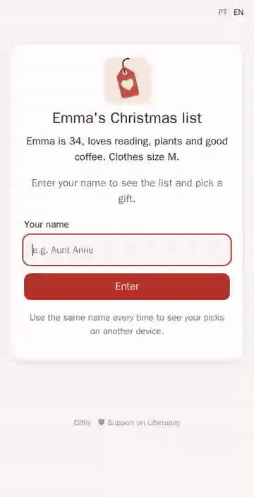
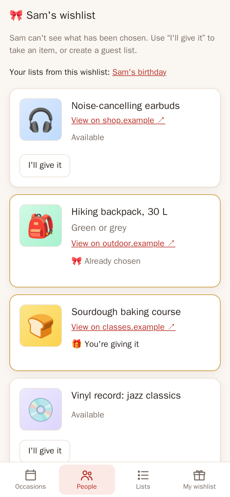
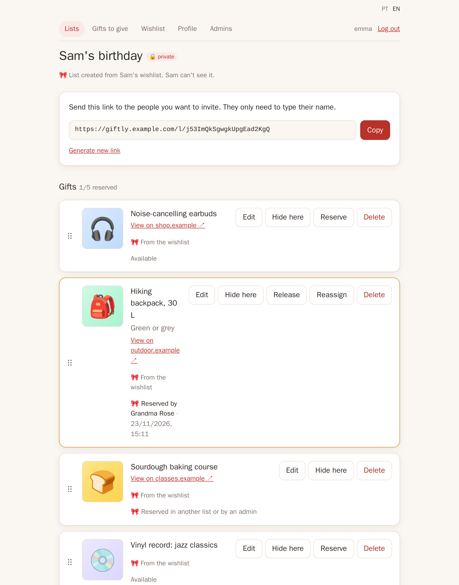
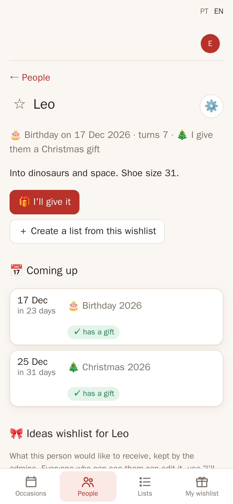

<p align="center">
  
</p>

<h1 align="center">Giftly</h1>

Self-hosted gift lists for families and friends.

- You create a list in the admin and add gifts: links to any shop, or plain items without a link.
- You share the list's **secret link**. People open it, type their name, and pick what they'll give.
- A picked gift **disappears for everyone else**, so no two people buy the same thing.
- Gifts with a link show the **shop's product image and price** automatically. Prices are re-checked daily and are never typed by hand.
- **Several admins**, each with their own account, and optional **notifications** (ntfy, Telegram, Discord/Slack webhook) when someone picks a gift.
- The admin always shows everything: who picked what and when, and who joined.
- **Wishlists:** every admin keeps a personal wishlist, and every person in "gifts to give" has one too. Create guest lists from them (linked and kept in sync) or take an item with "I'll give it"; an admin never sees what was reserved for them.
- **Gifts to give:** keep track of the gifts *you* give: people, birthdays, Christmas and other occasions, with a checklist per occasion, what each person got last year, shared or private entries per admin, and **reminders** when a gift is still missing.

<p align="center">
  
</p>

<p align="center">
  
  &nbsp;
  
  &nbsp;
  
</p>

<details>
<summary><strong>Admin view</strong></summary>
<p align="center">
  
</p>
<p align="center">
  
</p>
<p align="center">
  
</p>
</details>

<details>
<summary><strong>Wishlists</strong></summary>
<p align="center">
  
  &nbsp;
  
</p>
<p align="center">
  
</p>
</details>

<details>
<summary><strong>Gifts to give</strong></summary>
<p align="center">
  
  &nbsp;
  
  &nbsp;
  
</p>
</details>

Available in **Portuguese (pt-PT)** and **English**. The language follows the visitor's browser, and every page has a PT/EN switch.

Guests need no account and no email, and nothing is tracked. It is a single small container with a SQLite file, and the code has zero npm dependencies.

## Quick start

One step, on any machine with Docker (a NAS, a Raspberry Pi, a server):

```sh
curl -fsSL https://raw.githubusercontent.com/dfloureiro/Giftly/main/install.sh -o install.sh && sh install.sh
```

It asks for your domain and a [Cloudflare Tunnel](#exposing-it-with-cloudflare-tunnel) token (both optional), creates a strong admin password, starts Giftly and shows you how to log in. Without a tunnel, Giftly is only reachable from that machine at <http://localhost:3000/admin>. Files come from the latest release. You can read [the script](install.sh) first. Needs Docker Compose 2.24 or newer.

Running it again updates Giftly. It never changes your `.env` or `cloudflared.env`. It manages `compose.yaml` itself: the images are named **by digest** (the exact image, not a tag that can move), and the file is rewritten on every update, so put your own changes in `compose.override.yaml` (a `compose.yaml` you had edited is kept next to it as `compose.yaml.local-<date>`). An update counts as successful only when Giftly serves your data (not just answers), and the tunnel is connected if you use one. Otherwise it puts back your settings, the exact previous images (by digest) and the [data release](#data-and-recovery) they served, checks that they work again, and tells you why. A failed download changes nothing.

The image follows `ghcr.io/dfloureiro/giftly:4`: fixes and new features within 4.x, never a breaking 5.0. To follow an exact version, set `GIFTLY_TAG=4.0.0` in `.env`.

Or by hand with Docker Compose:

```sh
mkdir giftly && cd giftly
curl -O https://raw.githubusercontent.com/dfloureiro/Giftly/main/compose.yaml
printf 'ADMIN_USERNAME=me\nADMIN_PASSWORD=%s\n' "$(openssl rand -base64 18)" > .env
cat .env                     # keep this password
docker compose up -d
```

Open <http://localhost:3000/admin>, log in with that username and password, and create your first list. They are only used to create the first account; afterwards you can remove them from `.env`.

Or with plain Docker:

```sh
docker run -d --name giftly -p 127.0.0.1:3000:3000 \
  -e ADMIN_USERNAME=me -e ADMIN_PASSWORD=your-long-password \
  -v giftly-data:/data \
  ghcr.io/dfloureiro/giftly:latest
```

## Configuration

| Variable | Default | |
|---|---|---|
| `ADMIN_USERNAME` | `admin` | Username of the first account. Only used on the very first start. |
| `ADMIN_PASSWORD` | — | Password of the first account (at least 8 characters). Only used on the very first start, when there are no accounts yet; ignored afterwards (with a warning). |
| `APP_LANG` | `pt` | Fallback language (`pt` or `en`) when the browser asks for neither. |
| `SITE_TITLE` | `Giftly` | Name shown on the home page and in the browser tab. |
| `BASE_URL` | auto | Public URL used for share, invite and new-password links and in notifications, e.g. `https://gifts.example.com`. **Set it** whenever Giftly is reachable from the internet. Without it, invite and new-password links can only be created on the machine running Giftly (`http://localhost`). |
| `TZ` | `Europe/Lisbon` | Time zone for dates in the admin. |
| `LINK_PREVIEWS` | `true` | Fetch product pages to show each gift's image and price. Set to `false` to turn it off. |
| `TRUST_PROXY` | `true` | Trust `CF-Connecting-IP` / `X-Forwarded-*` from a reverse proxy or Cloudflare Tunnel. They are only believed when the connection comes from a private or local address (the proxy next to Giftly), never from the internet. Set to `false` to never trust them. |
| `TRUSTED_PROXIES` | — | Optional: only these proxies may set those headers, as IPs or CIDR ranges, e.g. `172.18.0.0/16`. Empty means any private or local peer. |
| `NOTIFY_ALLOWED_HOSTS` | — | Notification servers on your own network that Giftly may send to, e.g. `ntfy.lan,192.168.1.10`. Local and private addresses are refused otherwise. |
| `COOKIE_SECURE` | `auto` | `auto` sets `Secure` cookies when the request came over HTTPS. |
| `SESSION_SECRET` | generated | Generated once and stored in `/data` if not set. |
| `REQUIRE_2FA` | `false` | Require two-factor authentication for every admin. |
| `CURRENCY` | `EUR` | Currency for prices typed by hand in *Gifts to give*. |
| `REMINDER_HOUR` | `9` | Hour of the day (0–23, in `TZ`) when daily reminders are sent. |
| `PORT` | `3000` | |

## Admin accounts

Each admin has their own account (username and password, no email needed).

- **Add an admin:** *Admins → Create invite link* and send the link. It is valid for 48 hours, works once, and the person picks their own username and password.
- **Profile:** change your name, username and password, and set up your notifications. Changing your password logs out your other devices.
- **Forgot a password:** another admin opens *Admins* and creates a *New-password link* for that account. If nobody can log in, run this on the server; it prints a one-time link:
  ```sh
  docker exec giftly node scripts/reset-password.js <username>
  docker exec giftly node scripts/invite.js          # or: a link to create a new admin account
  ```
- **Two-factor authentication (optional):** in *Profile → Two-factor authentication*, scan the QR code with any authenticator app (Google Authenticator, Aegis, 1Password, Bitwarden…) and confirm with a code. You get 10 single-use recovery codes. Logins then ask for the 6-digit code; a code can't be reused, and attempts are rate limited. New-password links also ask for the code. If someone loses their phone and recovery codes, another admin can turn their 2FA off in *Admins*, or run `docker exec giftly node scripts/disable-2fa.js <username>`.
- **Require 2FA for everyone:** set `REQUIRE_2FA=true`. Admins without 2FA can only set it up after logging in, and nobody can turn it off.
- Passwords are hashed with scrypt; sessions and links are random tokens and only their hashes are stored. Logins are rate limited.

**Upgrading from 1.x:** keep `ADMIN_PASSWORD` set for the first start of 2.0 (optionally with `ADMIN_USERNAME`, default `admin`). Giftly creates that account and moves your notification settings to it. You can then remove `ADMIN_PASSWORD` and any `NOTIFY_*` variables.

## Wishlists

Every admin has a personal wishlist (*Wishlist → Mine*): what they'd like to receive, in order of preference (↑/↓), with link, notes, and the shop's image and price, as for list gifts. Removing an item asks why: *I bought it*, *I don't want it any more*, or *I received it*.

Other admins (*Wishlist → Others'*) can:
- **Create a guest list from it:** choose the items. They stay **linked**, so when the owner edits an item the list follows, and new wishlist items join the list automatically (or wait for approval, per list). You can still add the list's own gifts, add notes, or hide a linked item in just that list.
- **Take an item with "I'll give it":** it is reserved in every list and becomes a private gift in *Gifts to give* for the chosen occasion. From a checklist, *Pick from their wishlist* does the same.

**The surprise is protected:**
- The owner **never** sees what was reserved: their wishlist page is byte-for-byte the same either way, and removing a reserved item gives exactly the same answer as removing any other.
- A list made from someone's wishlist is **never visible to them**, even if shared with the other admins, and its notifications never reach them. This rule is enforced by the app and tested, so you can't create a list from your own wishlist.
- A wishlist item can only be reserved **once across every list** (and "I'll give it"); simultaneous attempts are safe.
- If the owner removes an item someone already reserved, that guest keeps it in their picks with a note ("they already bought it — don't buy it"), and the list's organiser (or the admin giving it) is notified.
- When a list is archived, or a gift from the wishlist is marked *given*, the item leaves the owner's active wishlist (as received).

Lists also have an owner and can be **private** (only you) or **shared** (all admins). Lists from before 3.0 stay shared.

## Gifts to give

A separate part of the admin (*Gifts to give*) to plan the gifts **you** give, not tied to the public lists.

- **People:** name, birthday (day and month, year optional for ages), notes, and whether you give them a Christmas gift.
- **Occasions:** birthdays appear on their own every year, from each person's date. *Create Christmas YYYY* creates that year's Christmas with everyone marked for Christmas, and you can add or remove people just for that year. Marking someone for Christmas later also adds them to this year's Christmas if it already exists. Custom occasions (christenings, weddings…) have a name, a date and participants.
- **Favourites and search:** star the people you give to most (favourites are per admin and come first), and search people (name or notes) and occasions as you type.
- **Duplicate an occasion** for the next year, with the same people (gifts aren't copied).
- **A wishlist for everyone:** each person has a wishlist on their page (what they'd like to receive). Every admin who can see the person can edit it, mark what's taken and use **"I'll give it"**. Create guest lists from it (e.g. so the grandparents can pick), linked and kept in sync just like an admin's wishlist: one reservation counts on every list. For a person who is an admin, their page shows two: that admin's own wishlist (read-only) and **ideas for them** that the other admins keep (editable like anyone's). A list can mix items from both, and the admin never sees the ideas nor any list with their items.
- **Gift history** per person: what you gave, by occasion and birthday (to buy → bought → given).
- **Checklist per occasion**, made for the phone: "12 of 18 people already have a gift", total spent, each person's gifts (to buy → bought → given), what they actually got the year before, and a filter for people still without a gift.
- **Upcoming:** the next 60 days, with "has a gift / ideas / no gift yet" for each occasion.
- **Joint gifts:** a gift can be for several people, for example one Christmas gift for a couple. It counts as a gift for each of them, shows in each one's history, and enters the total spent once. Their birthday gifts stay individual.
- **Gifts** can have a link, notes, an image (read from the link or uploaded) and a price. The price comes from the shop's page when it shows one, and is kept up to date while the gift is still an idea. It freezes once the gift is bought, so totals reflect what you paid. When the shop shows no price, you type it. `CURRENCY` (default `EUR`) is used for typed prices.
- **Shared or private:** every person, occasion and gift is *shared* (all admins see it) or *private* (only whoever created it). A private gift for a shared person, for example a surprise for the other admin, stays hidden from them everywhere, including progress and totals. A joint gift is only shown to someone who can see every person it is for. Only the creator can change who sees an entry. Removing an admin deletes their private entries and keeps the shared ones.

**Reminders:** once a day (at `REMINDER_HOUR`, default 9:00 in `TZ`) each admin gets a message on their own notification channels for every birthday or occasion that is coming up and still has no gift bought, for example *"In 14 days: Ana's birthday. No gift bought yet (2 ideas noted)."* or *"In 3 days: Christmas 2026. 6 of 18 people still without a gift."*. Each admin chooses how many days before in their **Profile** (default 14 and 3; empty turns reminders off) and can send today's reminders on demand to check. Reminders only include what that admin can see, so shared occasions remind everyone and private ones only their owner. Each reminder is sent once; if the server was off on the exact day, it goes out on the next run.

The privacy is enforced by the app; whoever has access to the server or the `/data` volume can read the database.

## Notifications

Each admin sets up their own notifications under **Profile → Notifications**: which events (someone picks a gift, gives one up, or opens a list for the first time) and one or more channels. **Send test notification** sends only to you.

| Channel | What you need |
|---|---|
| [ntfy](https://ntfy.sh) (free phone app) | A topic such as `https://ntfy.sh/giftly-<random>` or just `giftly-<random>` (letters, numbers, `-` and `_` only). Add an access token for protected or self-hosted servers. |
| Telegram | A bot token (from @BotFather) and your chat ID (send your bot a message, then open `https://api.telegram.org/bot<token>/getUpdates`). |
| Discord / Slack / anything else | A webhook URL. It receives a JSON POST with `content` (Discord), `text` (Slack), plus `event`, `list`, `guest`, `item`, `price`, `item_url` and `url`. |

Tokens are never shown back in the page: leave the field empty to keep the current one, or tick *Clear* to remove it. With `BASE_URL` set, each message links to the list in the admin. Messages use `APP_LANG`. A failing channel is logged and never affects guests.

On ntfy.sh, anyone who knows the topic name can read it, so make it long and random (for example `giftly-` followed by `openssl rand -hex 12`).

For safety, notifications are never sent to local or private addresses (`localhost`, `192.168.…`, `10.…`, and names that resolve to them), and redirects are not followed. That way a stolen admin account can't use Giftly to reach other services on your network. If your ntfy or webhook server runs on your own network, allow it with `NOTIFY_ALLOWED_HOSTS`, e.g. `NOTIFY_ALLOWED_HOSTS=ntfy.lan,192.168.1.10`.

## Exposing it with Cloudflare Tunnel

If your domain is on Cloudflare, you don't need to open any ports, set up a reverse proxy or get certificates:

1. In Cloudflare, open **Zero Trust → Networks → Tunnels**, create a tunnel (type *Cloudflared*) and copy its token.
2. Add a **public hostname** to the tunnel, e.g. `gifts.example.com`, with service `http://giftly:3000`.
3. Run the [one-step install](#quick-start) and paste the domain and token when asked.

Doing it by hand instead: put `TUNNEL_TOKEN=...` in `cloudflared.env` (Giftly itself never sees it), `BASE_URL=https://gifts.example.com` in `.env`, and run `docker compose --profile tunnel up -d`.

Optionally, protect `/admin` with a Cloudflare Access policy for extra safety.

## How it works

- **Access:** every list has an unguessable link (`/l/<22 random characters>`). Anyone with the link can join. Use *Generate new link* in the admin to revoke the old one, which also logs out everyone who joined.
- **Identity:** a guest is identified by their name within a list (not case-sensitive). Typing the same name on another device shows the same picks. This is intentionally simple and built for trust between family and friends, not for strangers.
- **Order:** drag gifts by their handle (⋮⋮) to reorder a list or your wishlist, with the mouse or a finger. The ↑/↓ buttons remain as a fallback without JavaScript.
- **Picks:** picks are atomic, so if two people click at the same moment, only one gets the gift. Guests can give up their own picks. In the admin you can release any gift.
- **Reserving on someone's behalf:** use *Reserve* on a gift and type a name (or pick a guest who already joined), for someone who told you in person. The reservation belongs to that guest: when they open the list with that name, they see it in their picks ("Reserved for you by …") and can give it up. The other admins are notified.
- **Images:** when you add a link, the server fetches the page in the background, reads its Open Graph, Twitter card, JSON-LD or microdata product image (with Amazon-specific fallbacks), and **stores a copy of the image** with your data. Guests never load anything from the shops. Some shops block automated requests (e.g. Akamai-protected ones); in that case, **upload a photo** (resized in the browser) or paste an image link. An image is only ever replaced by another image.
- **Prices:** prices only come from the shop link (`product:price`, JSON-LD offers, microdata, Amazon page data) and there is no price field. Available gifts are re-checked once a day, and the last known price is kept if a check fails. Gifts without a link, or from shops that block us, show no price. Requests to private and internal addresses are refused, and only JPEG, PNG, WebP, GIF and AVIF up to 5 MB are accepted.
- **Archive:** archive a list to close it without deleting anything.

## Data and recovery

Everything Giftly keeps is in `/data` (the `data/` folder next to `compose.yaml`), in **releases**:

```
data/
  current -> releases/2026-11-23T15-00-00-000Z      the release Giftly serves
  releases/
    2026-11-23T15-00-00-000Z/   giftly.db, images/, .session-secret, manifest.json
    2026-11-20T09-00-00-000Z/   …
```

Restoring a backup and upgrading the database never change the data they might need to return to. Each one creates a **new release**, and switching between releases is one atomic step (the `current` link). Each release has a `manifest.json` with the Giftly version, the database schema, where it came from (`initial`, `upgrade`, `restore`), its parent release, and a fingerprint of its data. Giftly refuses to serve a release that doesn't match its fingerprint the first time it opens it.

- **Upgrades:** when a new Giftly needs a newer database schema, it copies the current release (photos are hard links, so they take no extra space), upgrades **the copy**, and only then switches `current` to it. If that fails, it doesn't start, and `current` still points to the untouched previous release. This works the same with `install.sh`, plain Compose or `docker run`.
- **Retention:** the newest 3 releases are kept, plus the current one and its parent. Older ones are removed when Giftly starts.
- **From Giftly 3.x:** on its first start, Giftly 4 *copies* the old `data/giftly.db` and `data/images/` into the first release. The old files stay where they are, untouched, so going back to 3.x still finds them. (If a 3.x runs on them again, the next Giftly 4 copies them again.) Once you're happy with 4.x, you can delete `data/giftly.db*`, `data/images/`, `data/.session-secret` and any `data/pre-upgrade-*`, `data/pre-restore-*`, `data/failed-*` folders left by 3.x.

**Rolling back by hand:** stop Giftly, point `current` at the release you want, put the previous image back, and start it:

```sh
docker compose stop giftly
docker compose run --rm --no-deps --entrypoint node giftly scripts/release.js list     # * = current
docker compose run --rm --no-deps --entrypoint node giftly scripts/release.js switch 2026-11-20T09-00-00-000Z
# install.sh users: the previous compose.yaml (with its image digests) is in .giftly-backup/<date>/
docker compose up -d
```

### Backups

`scripts/backup.sh` saves the current release (database, photos, fingerprint) into one file, **outside** the data folder, while Giftly keeps running:

```sh
cd giftly                                   # the folder with compose.yaml
curl -fsSLO https://raw.githubusercontent.com/dfloureiro/Giftly/main/scripts/backup.sh
curl -fsSLO https://raw.githubusercontent.com/dfloureiro/Giftly/main/scripts/restore.sh
sh backup.sh --keep 14                      # → backups/giftly-backup-<date>.tar.gz (newest 14 kept)
```

Not using Compose (e.g. Portainer)? Add `GIFTLY_CONTAINER=<container name>`. `BACKUP_DIR` chooses where the file goes. The work is done inside the container by `scripts/backup.js`.

- **Copy it to another machine as well.** A backup on the same disk is lost with that disk. For example, use `rsync -a backups/ nas:/backups/giftly/`, [restic](https://restic.net), or a synced folder.
- The file contains password hashes and two-factor secrets. It's written as private (`600`): keep it that way, and encrypt it if it leaves your machines.
- By default it leaves out the session secret; a restore then keeps the one in use, so on the same machine nobody is signed out. `--include-secrets` brings the backup's own secret along (useful on a new machine, where guests and admins would otherwise sign in again), which makes the file more sensitive.
- A backup is only written if it is complete: it holds exactly the photos its database uses. If a photo is replaced while it runs, it tries again from a fresh snapshot. If it still can't be completed, it says which photos are missing, exits with an error (so cron notices), writes nothing and doesn't prune older backups. `--allow-missing-images` writes it anyway and lists the missing photos in the backup.
- **Backups from Giftly 3.x can't be restored by Giftly 4.** Take a new backup after updating.

**Daily, with cron** (`crontab -e`):

```
30 3 * * * cd /home/me/giftly && sh backup.sh --keep 14 >> backups/backup.log 2>&1
```

**Restore** (on the same or a new machine, after installing Giftly there):

```sh
sh restore.sh backups/giftly-backup-20261123-033000.tar.gz
```

1. While Giftly keeps running, it checks the backup and unpacks it into a **new release**. It checks that the archive holds only the expected files, every checksum, that it doesn't come from a newer Giftly, the database itself, that every photo it uses is there, and the fingerprint. A backup that fails any check is refused before Giftly is stopped, and nothing changes. (`--allow-missing-images` accepts one with missing photos.)
2. It stops Giftly, switches `current` to the new release and starts Giftly. Restore succeeds only if Giftly then **serves that release** (an older backup is upgraded into a new release automatically).
3. Otherwise it switches `current` back to the previous release, starts Giftly again and checks that it serves it. It still exits with an error and tells you where the failed release is (kept for inspection).

The previous release is never modified. A Giftly that was stopped before the restore stays stopped: the switch is done, and Giftly checks the release when it starts.

## Development

Requires Node.js 24+:

```sh
ADMIN_USERNAME=dev ADMIN_PASSWORD=dev-password npm run dev
npm test        # end-to-end tests against a real server + parser unit tests
```

To regenerate the README screenshots with mock data (needs podman or docker): `tools/screenshots/run.sh`.

CI runs the tests on every push and pull request, and only builds the image if they pass. The image is also rebuilt every week, so `latest` gets Node and Alpine security fixes even without code changes. Dependabot proposes updates to the GitHub Actions and the base image.

## License

[GPL-3.0](LICENSE)

## Support

If Giftly is useful to you, you can support its development:

<a href="https://liberapay.com/dfloureiro/donate"></a>
