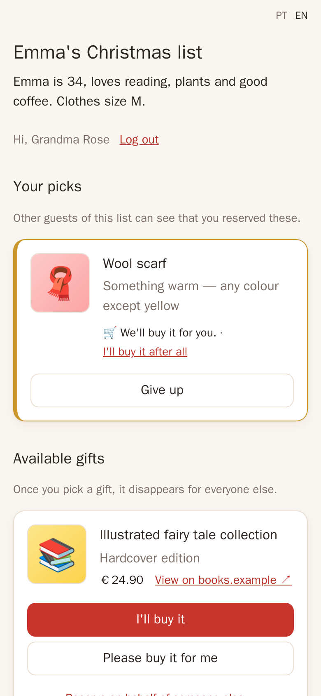
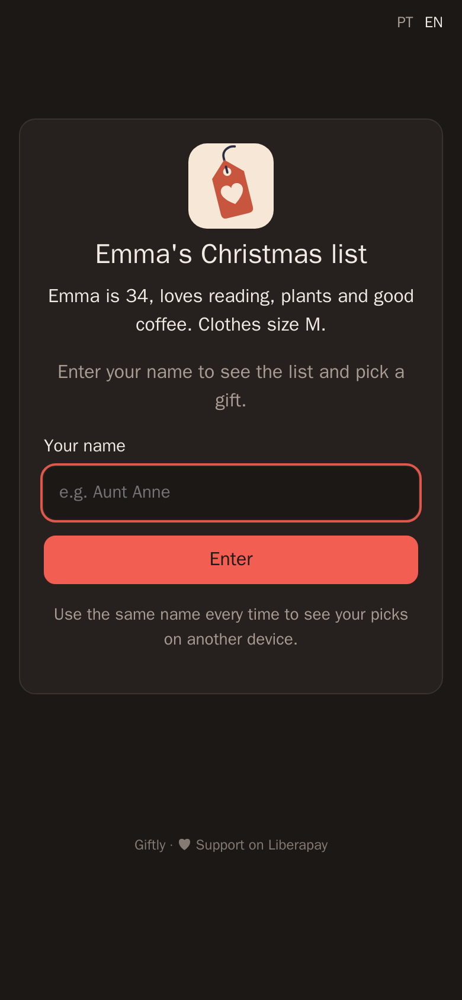
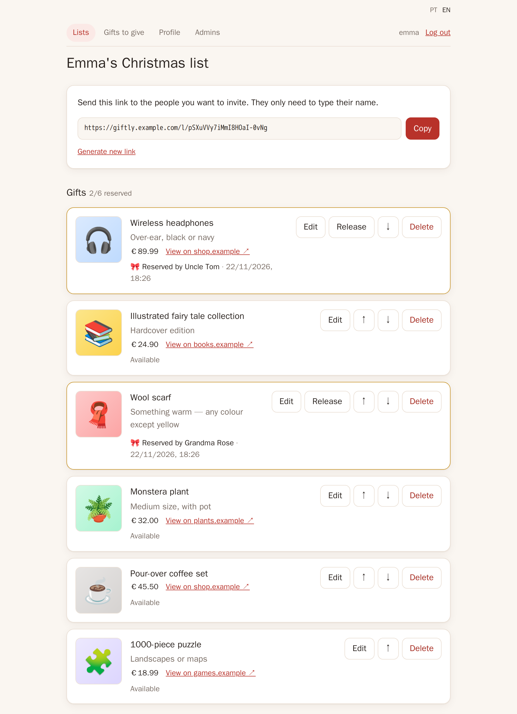
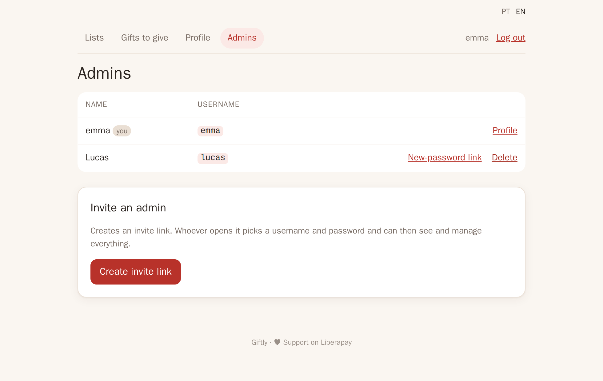

<p align="center">
  
</p>

<h1 align="center">Giftly</h1>

Self-hosted gift lists for families and friends.

- You create a list in the admin and add gifts: links to any shop, or plain items without a link.
- You share the list's **secret link**. People open it, type their name, and pick what they'll give.
- A picked gift **disappears for everyone else**, so no two people buy the same thing.
- Gifts with a link show the **shop's product image and price** automatically. Prices are re-checked daily and are never typed by hand.
- **Several admins**, each with their own account, and optional **notifications** (ntfy, Telegram, Discord/Slack webhook) when someone picks a gift.
- The admin always shows everything: who picked what and when, and who joined.
- **Gifts to give:** keep track of the gifts *you* give: people, birthdays, Christmas and other occasions, with a checklist per occasion, what each person got last year, and shared or private entries per admin.

<p align="center">
  
</p>

<p align="center">
  
  &nbsp;
  
</p>

<details>
<summary><strong>Admin view</strong></summary>
<p align="center">
  
</p>
<p align="center">
  
</p>
<p align="center">
  
</p>
</details>

<details>
<summary><strong>Gifts to give</strong></summary>
<p align="center">
  
  &nbsp;
  
  &nbsp;
  
</p>
</details>

Available in **Portuguese (pt-PT)** and **English**. The language follows the visitor's browser, and every page has a PT/EN switch.

Guests need no account and no email, and nothing is tracked. It is a single small container with a SQLite file, and the code has zero npm dependencies.

## Quick start

```sh
mkdir giftly && cd giftly
curl -O https://raw.githubusercontent.com/dfloureiro/giftly/main/compose.yaml
printf 'ADMIN_USERNAME=me\nADMIN_PASSWORD=%s\n' "$(openssl rand -base64 18)" > .env
cat .env                     # keep this password
docker compose up -d
```

Open <http://localhost:3000/admin>, log in with that username and password, and create your first list. They are only used to create the first account; afterwards you can remove them from `.env`.

Or with plain Docker:

```sh
docker run -d --name giftly -p 3000:3000 \
  -e ADMIN_USERNAME=me -e ADMIN_PASSWORD=your-long-password \
  -v giftly-data:/data \
  ghcr.io/dfloureiro/giftly:latest
```

## Configuration

| Variable | Default | |
|---|---|---|
| `ADMIN_USERNAME` | `admin` | Username of the first account. Only used on the very first start. |
| `ADMIN_PASSWORD` | — | Password of the first account (at least 8 characters). Only used on the very first start, when there are no accounts yet; ignored afterwards (with a warning). |
| `APP_LANG` | `pt` | Fallback language (`pt` or `en`) when the browser asks for neither. |
| `SITE_TITLE` | `Giftly` | Name shown on the home page and in the browser tab. |
| `BASE_URL` | auto | Public URL used for the share link in the admin, e.g. `https://gifts.example.com`. |
| `TZ` | `Europe/Lisbon` | Time zone for dates in the admin. |
| `LINK_PREVIEWS` | `true` | Fetch product pages to show each gift's image and price. Set to `false` to turn it off. |
| `TRUST_PROXY` | `true` | Trust `CF-Connecting-IP` / `X-Forwarded-*`. Set to `false` if the app is exposed directly. |
| `COOKIE_SECURE` | `auto` | `auto` sets `Secure` cookies when the request came over HTTPS. |
| `SESSION_SECRET` | generated | Generated once and stored in `/data` if not set. |
| `CURRENCY` | `EUR` | Currency for prices typed by hand in *Gifts to give*. |
| `PORT` | `3000` | |

## Admin accounts

Each admin has their own account (username and password, no email needed).

- **Add an admin:** *Admins → Create invite link* and send the link. It is valid for 48 hours, works once, and the person picks their own username and password.
- **Profile:** change your name, username and password, and set up your notifications. Changing your password logs out your other devices.
- **Forgot a password:** another admin opens *Admins* and creates a *New-password link* for that account. If nobody can log in, run this on the server; it prints a one-time link:
  ```sh
  docker exec giftly node scripts/reset-password.js <username>
  docker exec giftly node scripts/invite.js          # or: a link to create a new admin account
  ```
- Passwords are hashed with scrypt; sessions and links are random tokens and only their hashes are stored. Logins are rate limited.

**Upgrading from 1.x:** keep `ADMIN_PASSWORD` set for the first start of 2.0 (optionally with `ADMIN_USERNAME`, default `admin`). Giftly creates that account and moves your notification settings to it. You can then remove `ADMIN_PASSWORD` and any `NOTIFY_*` variables.

## Gifts to give

A separate part of the admin (*Gifts to give*) to plan the gifts **you** give, not tied to the public lists.

- **People:** name, birthday (day and month, year optional for ages), notes, and whether you give them a Christmas gift.
- **Occasions:** birthdays appear on their own every year, from each person's date. *Create Christmas YYYY* creates that year's Christmas with everyone marked for Christmas, and you can adjust who's in just for that year. Custom occasions (christenings, weddings…) have a name, a date and participants.
- **Checklist per occasion**, made for the phone: "12 of 18 people already have a gift", total spent, each person's gifts (idea → bought → given), what they got the year before, and a filter for people still without a gift.
- **Upcoming:** the next 60 days, with "has a gift / ideas / no gift yet" for each occasion.
- **Gifts** can have a link, notes, an image (read from the link or uploaded) and a price. The price comes from the shop's page when it shows one, and is kept up to date while the gift is still an idea. It freezes once the gift is bought, so totals reflect what you paid. When the shop shows no price, you type it. `CURRENCY` (default `EUR`) is used for typed prices.
- **Shared or private:** every person, occasion and gift is *shared* (all admins see it) or *private* (only whoever created it). A private gift for a shared person, for example a surprise for the other admin, stays hidden from them everywhere, including progress and totals. Only the creator can change who sees an entry. Removing an admin deletes their private entries and keeps the shared ones.

The privacy is enforced by the app; whoever has access to the server or the `/data` volume can read the database.

## Notifications

Each admin sets up their own notifications under **Profile → Notifications**: which events (someone picks a gift, gives one up, or opens a list for the first time) and one or more channels. **Send test notification** sends only to you.

| Channel | What you need |
|---|---|
| [ntfy](https://ntfy.sh) (free phone app) | A topic such as `https://ntfy.sh/giftly-<random>` or just `giftly-<random>` (letters, numbers, `-` and `_` only). Add an access token for protected or self-hosted servers. |
| Telegram | A bot token (from @BotFather) and your chat ID (send your bot a message, then open `https://api.telegram.org/bot<token>/getUpdates`). |
| Discord / Slack / anything else | A webhook URL. It receives a JSON POST with `content` (Discord), `text` (Slack), plus `event`, `list`, `guest`, `item`, `price`, `item_url` and `url`. |

Tokens are never shown back in the page: leave the field empty to keep the current one, or tick *Clear* to remove it. With `BASE_URL` set, each message links to the list in the admin. Messages use `APP_LANG`. A failing channel is logged and never affects guests.

On ntfy.sh, anyone who knows the topic name can read it, so make it long and random (for example `giftly-` followed by `openssl rand -hex 12`).

## Exposing it with Cloudflare Tunnel

If your domain is on Cloudflare, you don't need to open any ports:

1. In Cloudflare go to **Zero Trust → Networks → Tunnels → Create a tunnel** (type *Cloudflared*), and copy the token.
2. Add a **public hostname**, e.g. `gifts.example.com`, with service `http://giftly:3000`.
3. Put the token in `.env` as `TUNNEL_TOKEN=...` and set `BASE_URL=https://gifts.example.com`.
4. Run `docker compose --profile tunnel up -d`.

Optionally, protect `/admin` with a Cloudflare Access policy for extra safety.

## How it works

- **Access:** every list has an unguessable link (`/l/<22 random characters>`). Anyone with the link can join. Use *Generate new link* in the admin to revoke the old one, which also logs out everyone who joined.
- **Identity:** a guest is identified by their name within a list (not case-sensitive). Typing the same name on another device shows the same picks. This is intentionally simple and built for trust between family and friends, not for strangers.
- **Picks:** picks are atomic, so if two people click at the same moment, only one gets the gift. Guests can give up their own picks. In the admin you can release any gift, or mark one as reserved by name for someone who told you in person.
- **Images:** when you add a link, the server fetches the page in the background, reads its Open Graph, Twitter card, JSON-LD or microdata product image (with Amazon-specific fallbacks), and **stores a copy of the image** in `/data/images`. Guests never load anything from the shops. Some shops block automated requests (e.g. Akamai-protected ones); in that case, **upload a photo** (resized in the browser) or paste an image link. An image is only ever replaced by another image.
- **Prices:** prices only come from the shop link (`product:price`, JSON-LD offers, microdata, Amazon page data) and there is no price field. Available gifts are re-checked once a day, and the last known price is kept if a check fails. Gifts without a link, or from shops that block us, show no price. Requests to private and internal addresses are refused, and only JPEG, PNG, WebP, GIF and AVIF up to 5 MB are accepted.
- **Archive:** archive a list to close it without deleting anything.

## Backups

Everything lives in `/data`: `giftly.db` (SQLite, WAL mode) and `images/`. To back it up while running:

```sh
docker compose exec giftly node -e "new (require('node:sqlite').DatabaseSync)('/data/giftly.db').exec(\"VACUUM INTO '/data/backup.db'\")"
```

## Development

Requires Node.js 24+:

```sh
ADMIN_USERNAME=dev ADMIN_PASSWORD=dev-password npm run dev
npm test        # end-to-end tests against a real server + parser unit tests
```

CI runs the tests on every push and pull request, and only builds the image if they pass. The image is also rebuilt every week, so `latest` gets Node and Alpine security fixes even without code changes. Dependabot proposes updates to the GitHub Actions and the base image.

## License

[GPL-3.0](LICENSE)

## Support

If Giftly is useful to you, you can support its development:

<a href="https://liberapay.com/dfloureiro/donate"></a>
